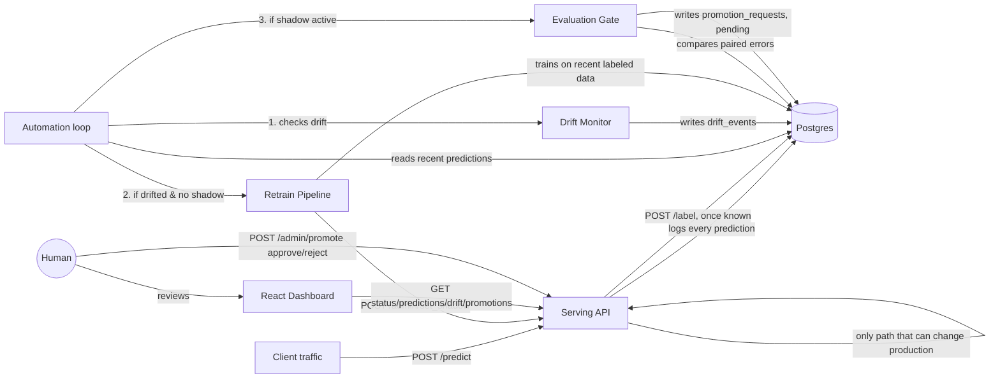

# Drift-Watchdog

A self-healing MLOps pipeline: it serves a live model, detects when the
model's world has changed (data drift), automatically retrains and shadow-
tests a replacement against real traffic, and asks a human to approve
before that replacement ever serves a live prediction.

**Core rule the whole system is built around: nothing gets promoted to
production without a human clicking approve.** Every automatic step
(retraining, shadow deployment, statistical evaluation) is designed to be
safe to run unattended precisely because none of it can flip that switch.

## Why this exists

Models decay silently. A delivery-time model trained on last year's traffic
patterns quietly gets worse when monsoon season changes travel times — not
with an error, just a slow drift into wrong answers, usually discovered
weeks later via complaints. This project is a small, working version of the
system that catches that early: it watches the model's real input data for
statistically significant drift, and when it finds it, builds and proves a
replacement automatically — without ever being trusted to make the final
call itself.

## Architecture



## The five pieces

| Component | What it does | Where |
|---|---|---|
| **Serving API** | Serves predictions from the current production model, logs every prediction (and shadow prediction, if one exists), accepts true labels once known | `serving/app.py` |
| **Drift Monitor** | KS-test comparing recent live input features against the original training distribution; flags drift when 2+ features shift significantly | `monitor/drift_monitor.py` |
| **Retrain Pipeline** | Trains a challenger on recent *labeled* live data (not the stale original set) and deploys it to shadow — visible in every prediction's logs, never served to a real caller | `retrain/retrain_pipeline.py` |
| **Evaluation Gate** | Pairs production's and the challenger's predictions on the same real requests, runs a Wilcoxon signed-rank test on their errors, and only creates a promotion request if the improvement is real and statistically significant | `evaluation/evaluation_gate.py` |
| **Automation Loop** | Runs the above three on a schedule, holding off retraining again while a challenger is already awaiting evaluation. Runs inside the serving process and is started/stopped from the dashboard's **Automation** card (or headless, see below) | `automation/loop.py`, `automation/controller.py` |
| **Dashboard** | React UI: honest status (offline / waiting / normal / drift), the Automation start/stop card, drift history, recent predictions, and the *only* place a human clicks approve/reject (with a confirmation showing the evidence) | `dashboard/` |

## Human approval — the one thing automation can never do

`POST /admin/promote` in `serving/app.py` is the single code path capable of
changing which model serves production traffic. It requires an existing
promotion request (which only the evaluation gate can create, and only
after a statistical test passes) and an explicit `approve` or `reject`
decision. The automation loop never calls it. There is no scheduled job,
no auto-approval threshold, no timeout that promotes a model on its own.

Two guards keep that claim true in practice:

- Every `/admin/*` endpoint (including the dashboard's action buttons)
  requires a signed-in session, and CORS only allows the dashboard's own
  origin, so another website open in your browser can't trigger them. Guest
  and read-only accounts get `403` on every route that changes anything, so
  they can look but never approve. See [Signing in](#signing-in).
- The **Train Baseline** button only creates the *first* model (v1) and
  refuses to overwrite one that exists. Replacing what serves production
  always goes retrain → shadow → evaluation gate → human approval.

## Restart safety: the DB decides what is production

Which model is `production` and which (if any) is `shadow` is stored in the
`model_registry` table (`version`, `role` = `production | shadow | archived |
rejected`, `created_at`, `promoted_at`, plus optional `trained_on_rows` /
`metrics` / `reference_path`). The in-memory `STATE` in `serving/app.py` is only
a cache for the `/predict` hot path: every change writes the DB first, then the
cache, and `startup()` rebuilds the cache from the table. So an approved
promotion survives a restart. Partial unique indexes make "exactly one
production, at most one shadow" a database guarantee.

- **Approve** validates that the challenger is the current shadow (else `409
  stale request`) and that its model + preprocessor *load* (else `500`, and
  nothing in the DB changes); then, in one transaction, it marks the request
  approved, archives the old production, makes the challenger production and
  clears the shadow slot.
- **Reject** marks the request and the challenger `rejected` and frees the shadow
  slot, so *Retrain Challenger* works again.
- **`set_shadow`** archives the previous shadow. A pending request for a
  challenger that stopped being the shadow is marked `withdrawn`.
- **Upgrading an older DB**: if `model_registry` is empty at startup it is seeded
  with production = the challenger of the most recent *approved* promotion request
  (otherwise `v1`), so an approval that already exists is never lost.

The registry (and the automation state below) assume **one serving process / one
uvicorn worker**; with several workers each would hold its own cache and scheduler.

## Automation loop: start/stop from the dashboard

The **Automation** card in the dashboard starts and stops the drift → retrain →
gate loop. It runs inside the serving process (APScheduler `BackgroundScheduler`,
one job, `max_instances=1`, `coalesce=True`) and calls the serving code directly
rather than making HTTP requests to itself. It never promotes anything: a cycle
that passes the gate only creates a `pending` promotion request.

| Route (all need `X-API-Key`) | |
|---|---|
| `GET /admin/automation` | `{running, interval_seconds, next_run_at, last_cycle_at, last_cycle: {drift_checked, drift_triggered, action: none\|retrain\|gate, gate_result, error, message}, started_at, cycle_in_progress}` |
| `POST /admin/automation/start` `{interval_seconds?}` | start (idempotent); a new interval reschedules a running loop; first cycle runs one interval later |
| `POST /admin/automation/stop` | stop (idempotent); a cycle already running finishes |
| `POST /admin/automation/run_now` | run one cycle now in the background (`409` if one is running) |

- `enabled`, the interval and the last-cycle summary are stored in the
  `automation_state` table; if the loop was on, it is switched back on at startup.
- A cycle never crashes the scheduler: an exception is caught and shown as the
  cycle's `error`.
- The loop and the **Retrain** button share one lock (`RETRAIN_LOCK`). If a retrain is
  already running, the cycle skips retraining and says so.
- Retraining runs in a thread of the serving process, so `/predict` can be slower
  while a challenger trains.
- `CHECK_INTERVAL_SECONDS` is the default interval (60); the dashboard offers
  15 s – 15 min, the API accepts 5 s – 24 h.
- **Headless alternative**: `python -m automation.loop` (same cycle code, talks to a
  running API over HTTP) or, in Docker, `docker compose --profile headless up`. Do not
  run it *and* the dashboard loop at once: the in-process lock cannot see another process.

## How the loop measures things

- **Pairing is by request, not by timestep.** Every `/predict` returns a `request_id`; the
  shadow model's row shares it. `/label` back-fills the shadow row(s) with that id, and the
  evaluation gate compares production and challenger on exactly the same requests.
  `timestep` is optional metadata: real traffic has none, and replaying a stream can't mix
  up two different shadow models any more. (Rows logged before this existed have no id and
  are ignored by the gate.)
- **Drift is measured against the model that is serving.** Every model saves
  `models/reference_<version>.parquet` (the monitored features and the target of its own
  training rows). The drift monitor compares the latest window with the *current
  production* model's snapshot and records which version it used, so after you promote a
  challenger trained on the new regime the same traffic is no longer "drift" and the loop
  stops retraining for nothing. v1's snapshot is created from `data/training_data.csv` on
  demand; a model trained before snapshots existed falls back to v1's and the check says so.
- **Latency means inference only.** The timer starts after the model is loaded (a cold disk
  read is never counted), the first `LATENCY_WARMUP_CALLS` (3) requests of a freshly loaded
  model are scored but not timed, and everything is reported as **p50 and p95**, not a mean
  that one outlier can distort. Latency is shown to you; it does not decide the gate.
- **Stats describe the model in production now.** `/admin/stats` reports the MAE of the current
  production version only (null until it has labelled rows), the model's own validation
  error (`expected_mae`, from its meta file) and the warn/alert ratios the dashboard uses to
  colour the number: `MAE_WARN_RATIO` (default 1.3) and `MAE_ALERT_RATIO` (default 2.0).
- Existing databases are upgraded in place on start (`serving/db.py: migrate`): it inspects
  what is missing and adds only that, one transaction per change.

## Data

Uses the real **Kaggle House Prices — Advanced Regression Techniques**
dataset (`data/house_prices_raw.csv`, 1460 homes, 80 raw features), not
synthetic data. The model and preprocessing pipeline are lifted directly
from the user's own `housing.ipynb` notebook:

- **Preprocessing** (`data/house_price_preprocessor.py`): a proper fit/
  transform object reproducing the notebook's exact steps — "None" fills
  for features a house genuinely doesn't have, neighborhood-median
  `LotFrontage` imputation, ordinal encoding for 10 quality columns, one-
  hot encoding for the rest, with column alignment for anything scored
  later. Fit once on training data and saved alongside each model version
  (`preprocessor_v1.joblib`, etc.) so serving and retraining always apply
  an identical transform.
- **Model**: the user's own tuned `GradientBoostingRegressor`
  (`n_estimators=1500, learning_rate=0.05, max_depth=3, min_samples_leaf=2,
  min_samples_split=5, loss="huber"`), trained on `log1p(SalePrice)` — the
  best of everything tried in the notebook (Linear Regression, Ridge,
  Random Forest, untuned GB), at roughly 0.122 cross-validated log RMSE.

**Drift is still simulated**, per an earlier decision: this dataset has no
time axis, so `data/generate_dataset.py` splits the 1460 rows into a
training set and a "stream," then injects a genuine distribution shift
partway through the stream — `OverallQual` and `GrLivArea` pushed up,
`YearRemodAdd` nudged later — simulating a renovation/luxury wave in the
input data, in real feature columns, not synthetic noise.

**Drift monitoring** deliberately checks a **curated set of raw columns**
(`OverallQual`, `GrLivArea`, `YearBuilt`, `TotalBsmtSF`, etc.) rather than
the ~200 one-hot dummy columns the model actually trains on — running a
KS-test on a 0/1 dummy column is close to meaningless. This was flagged as
a design decision before building it, not decided silently.

**A known tradeoff, stated plainly**: training data here is roughly 876
rows (60% of the dataset, the rest held out for the stream), so the
baseline model's real Log RMSE is ~0.142 — noticeably worse than the
notebook's ~0.122, which trained on the full dataset. This is the honest
cost of having genuinely held-out data to simulate drift against, not a
bug. Training on the full dataset instead (closer to the notebook's exact
number) is a one-line change if preferred — ask, and it flips.

One real bug worth knowing about, found while building the earlier
synthetic-data version: calling `sklearn.make_regression` twice with
different seeds produces two *unrelated* regression problems, not two
samples of the same one, since the seed also controls the generated
coefficients. Fixed by generating one combined dataset and splitting rows
afterward — a pattern this project's real-data generator follows too
(split rows from ONE dataset, don't regenerate).

## Running it

### Locally (SQLite, no setup)
```bash
pip install -r requirements.txt
python -m data.generate_dataset
python -m models.train_baseline
cp .env.example .env     # then set ADMIN_USERNAME and ADMIN_PASSWORD (see "Signing in")
uvicorn serving.app:app --reload --port 8000          # terminal 1 (reads .env itself)
python simulator/stream_simulator.py --speed 0.02      # terminal 2
```
Start the loop from the dashboard's **Automation** card (no third terminal needed).
Run exactly **one** uvicorn worker (the default; don't pass `--workers N`).
The headless scripts (`python -m retrain.retrain_pipeline`, `python -m automation.loop`)
talk to the API without a login, so they need the optional machine key: set the same
`ADMIN_API_KEY` in `.env`.

### Model Context Protocol (MCP) Server for AI Tools
Drift-Watchdog includes an MCP server (`mcp_server.py`) allowing AI assistants (Claude Desktop, Cursor, Antigravity) to monitor and control the pipeline.

Run the MCP server directly:
```bash
python mcp_server.py
```

To connect it in Claude Desktop or Cursor, add this to your `claude_desktop_config.json`:
```json
{
  "mcpServers": {
    "drift-watchdog": {
      "command": "python",
      "args": ["-m", "mcp_server"],
      "cwd": "/path/to/drift-watchdog"
    }
  }
}
```

### With Postgres + full automation, via Docker Compose
```bash
cp .env.example .env        # then set ADMIN_PASSWORD (and optionally GROQ_API_KEY)
docker compose up --build
```
Compose refuses to start until `ADMIN_PASSWORD` is set in `.env`.
This starts Postgres, the serving API (one worker) and the dashboard at
`http://localhost:5173`. Switch the automation loop on from the dashboard's
Automation card; it checks every 60 s by default (`CHECK_INTERVAL_SECONDS`).

The separate `automation` service is under the `headless` profile, so a plain
`docker compose up` does not run a second loop next to the button. To run the loop
as its own container instead (and leave the card off):
```bash
docker compose --profile headless up --build
```

> **Honest note on the Compose setup**: the Postgres connection, the
> serving/retrain/monitor/gate code, and the automation loop have all been
> tested directly against a real Postgres instance and proven to work end
> to end. The `docker-compose.yml` and Dockerfiles themselves were written
> carefully but not run through Docker in the environment this was built
> in (no Docker available there). Run `docker compose up --build` yourself
> and report back anything that needs fixing.

### Signing in

The dashboard opens on a login page: **username + password**, or **Continue as guest**.

| Who | Can do |
|---|---|
| `admin` account | everything, including Retrain, Automation and approving promotions |
| `viewer` account / guest | look at everything; every `POST` under `/admin` is refused with `403` |

- **First account:** put `ADMIN_USERNAME` and `ADMIN_PASSWORD` (8+ characters) in `.env`.
  The server creates that admin on startup if it doesn't exist yet. It never overwrites
  an existing account, so a password you changed later isn't undone by an old `.env`.
  There is no default password.
- **More accounts:** `python -m serving.manage_users create alice` (add `--role viewer` for a
  read-only one); also `list`, `set-password`, `delete`.
- **Guest:** read-only, 2-hour session, no account. Turn it off with `GUEST_LOGIN_ENABLED=0`.
- **Safety:** passwords are stored as salted PBKDF2 hashes; five wrong attempts lock that
  username (and that client) for 60 seconds; a wrong username and a wrong password get the
  same answer; sessions expire (12 h, guests 2 h) and Sign out revokes them on the server.
- **Fails closed:** with no account and no key configured, `/admin/*` returns `503` and
  nobody (guests included) can sign in. `ADMIN_AUTH_DISABLED=1` switches checks off for
  local development only.
- **Optional machine key:** `ADMIN_API_KEY` is still accepted in an `X-API-Key` header, for the
  headless scripts only. The dashboard never asks for it.
- The server reads `.env` itself (variables already set in the environment win). The session
  token lives in the browser tab's `sessionStorage`.

`DASHBOARD_ORIGINS` (comma-separated) sets which browser origins may call the
API; the default is the local dashboard at `http://localhost:5173`. This is a small
single-operator login, not an identity platform: it protects the API from other
websites and other machines.

### The dashboard on its own
```bash
cd dashboard
npm install
npm run dev
```
Needs the serving API running at `localhost:8000` to show anything real, and an
account or the guest login.

### Tests
```bash
pip install -r requirements-dev.txt
pytest
```
The tests cover the admin-key protection (every `/admin` route, read from the
OpenAPI schema), CORS, upload validation, the baseline-overwrite guard, the retrain
locking, the model registry (restart safety, atomic approve/reject, legacy-DB
seeding) and the automation loop (start/stop, restore after restart, overlap and
lock handling, and that a cycle can never promote). They use a temporary SQLite DB
and a temporary models directory.

## What's genuinely tested vs. what to verify yourself

**Tested end-to-end, with real data, more than once:**
- Serving + logging (SQLite and Postgres)
- Drift monitor correctly staying quiet on clean data and firing on
  genuinely drifted data, identifying the exact drifted features
- Retrain pipeline producing a real challenger model from live traffic
- Shadow deployment — confirmed via logs that both models get scored,
  only production's answer is ever returned
- Evaluation gate — confirmed it passes on a real improvement (p≈0),
  and correctly refuses when a challenger isn't meaningfully better
- Human approval and rejection — confirmed production only changes on
  approve, and stays put (with the challenger still in shadow) on reject
- The full automation loop, unattended: detected drift, retrained,
  deployed to shadow, held off retraining again while shadow was active,
  and reached a promotion request once enough evidence existed — never
  touching production itself

**Not run in this environment, worth verifying yourself:**
- `docker compose up --build` end to end
- The dashboard rendered in an actual browser (verified it compiles and
  fetches real data correctly, but never visually inspected the pixels)

## AI-generated explanations (optional)

`llm/explain.py` calls Claude (Haiku — a fast, inexpensive model, appropriate
for short summaries of numbers the pipeline already computed) to generate
plain-English explanations:
- **Why drift was detected** — shown when you click a "drift detected" row
  in the dashboard's Drift monitor checks table
- **Why a promotion is recommended** — shown directly on each pending
  promotion request card, next to Approve/Reject

**This is additive, never load-bearing.** Every number in these
explanations comes from statistics the pipeline already computed (KS
scores, MAE, p-values) — Claude is only asked to phrase them in plain
English, never to invent its own analysis. If `GROQ_API_KEY` isn't
set, or the API call fails for any reason, the system falls back to a
deterministic, template-built explanation instead of breaking anything.
Drift detection, retraining, the evaluation gate, and human approval all
work identically whether or not this key is set.

**To enable real Claude-generated explanations**: copy `.env.example` to
`.env` in the project root and set `GROQ_API_KEY` — Docker Compose
picks it up automatically. Running locally without Docker, just export it
in your shell before running the monitor/gate/automation loop.

**One-time note if you already have a running Postgres volume from before this
feature**: this update adds new `explanation` columns to `drift_events` and
`promotion_requests`. This project doesn't use migrations (no Alembic), so
an existing database won't get the new columns automatically. Reset it once
with `docker compose down -v` (the `-v` wipes the Postgres volume) before
`docker compose up --build` again — you'll need to re-run
`python -m models.train_baseline` too, since that also wipes `model_v1`.

## Next steps, not yet built
- Swap in a real dataset (yours, or a live-changing public one)
- Prometheus/Grafana for infra-level monitoring (optional, from the
  original plan)
- A small LLM call to auto-generate a plain-English "why drift was
  detected" note next to each promotion request (nice-to-have)
